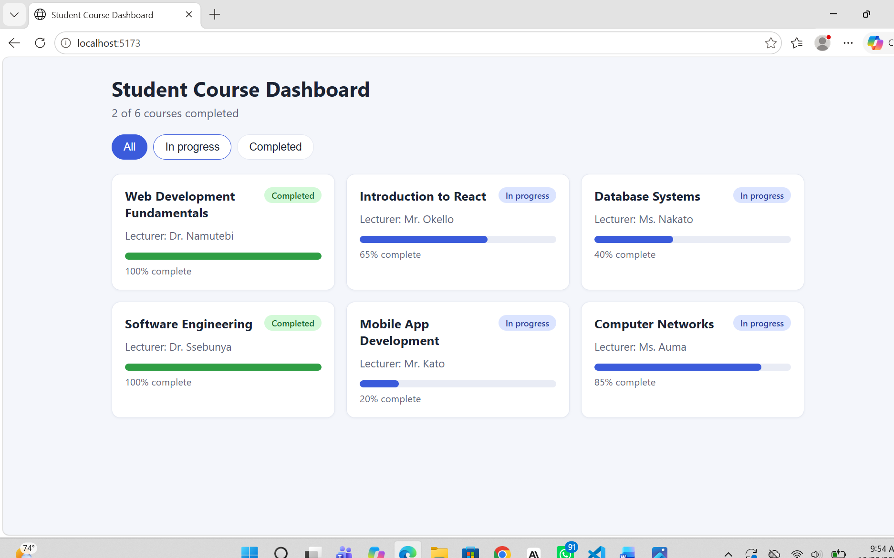

# Student Course Dashboard (Lab 1)

A small React app (Vite) that shows a student's courses as reusable cards.
It practises JSX, components, props, `map()` with keys, and conditional rendering.

## Setup

1. Install [Node.js](https://nodejs.org) (v18 or newer) and VS Code.
2. Open this folder in VS Code (or a terminal).
3. Install dependencies:
   ```bash
   npm install
   ```
4. Start the dev server:
   ```bash
   npm run dev
   ```
5. Open the local URL shown in the terminal (usually http://localhost:5173).

## Project structure

```
src/
  main.jsx                 entry point
  App.jsx                  page layout, filter state, renders the list
  components/CourseCard.jsx reusable card (receives props)
  data/courses.js          the courses array
  styles.css               styling + responsive layout
```

## Component tree

```
App
 ├─ header + filter buttons
 └─ CourseCard (one per course, key = course.id)
```

## How the lab requirements are met

- **Reusable card with props:** `CourseCard` receives `title`, `lecturer`, `progress`, `completed`.
- **Array rendering:** `App.jsx` uses `map()` with `key={course.id}`.
- **Conditional rendering:** badge shows *Completed* / *In progress* from the data; an empty-state message appears when no courses match.
- **Responsive:** 1 column on phones, 2 on tablets, 3 on desktop (CSS grid + media queries).

## Extension feature

Status filter buttons (**All / In progress / Completed**) using `useState`,
plus a summary line ("2 of 6 courses completed"). Choosing a filter with no
matching courses shows the empty state.

## Screenshots

Add two screenshots here after running the app:



